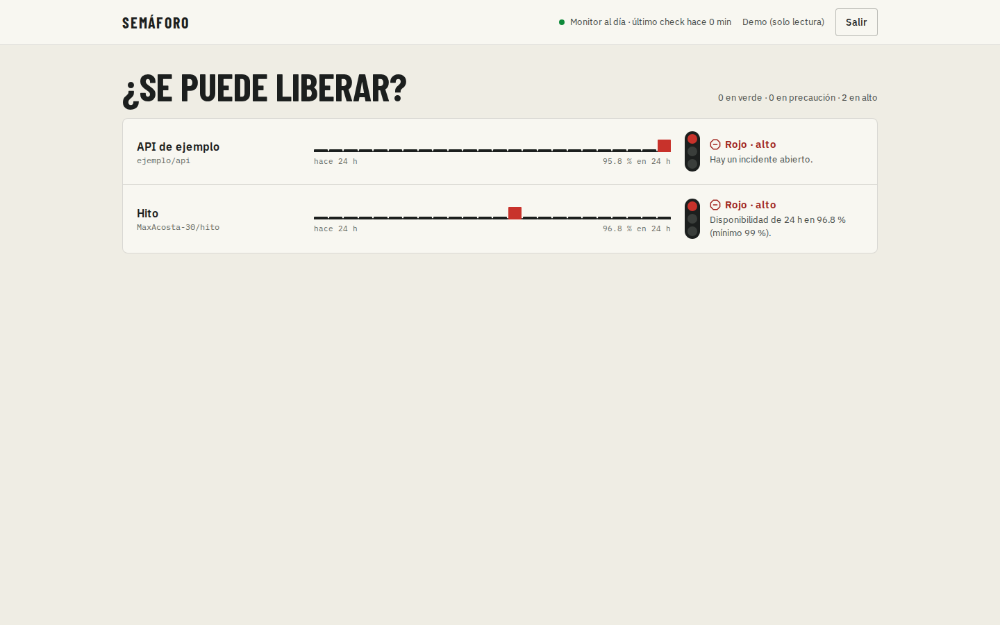
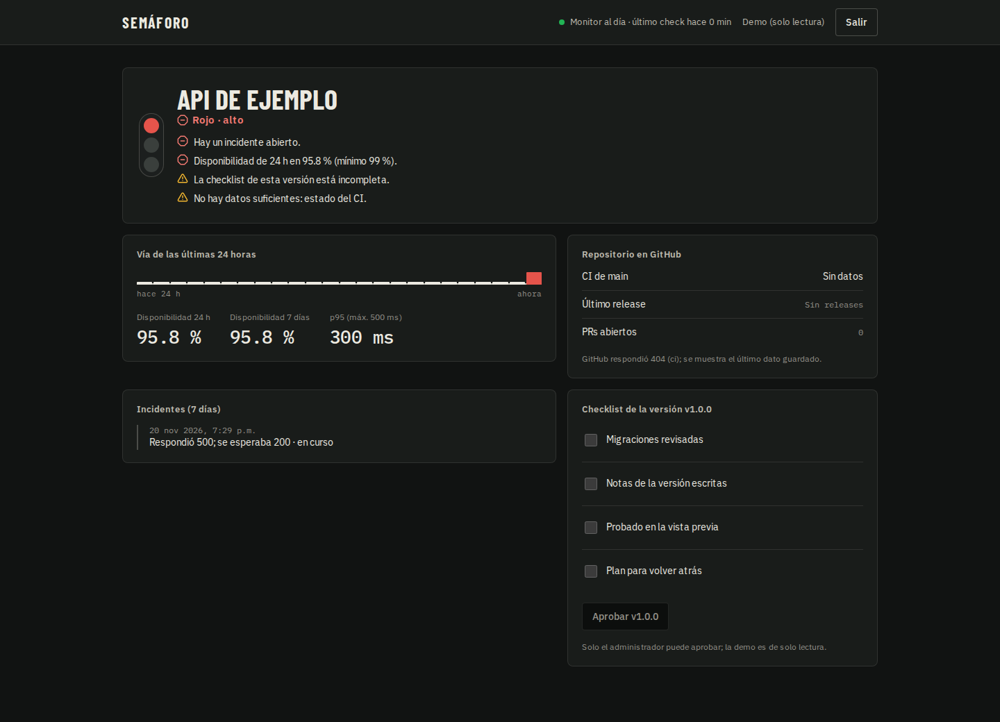
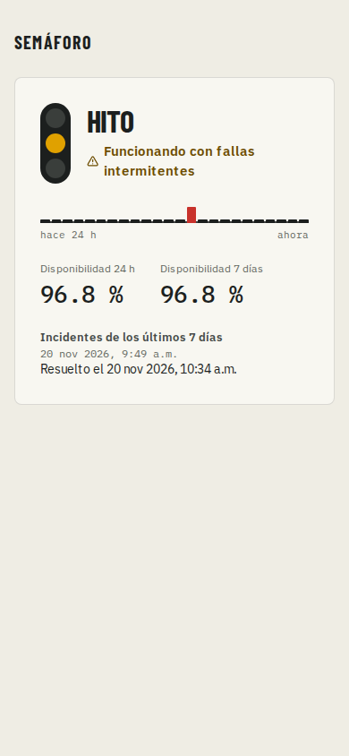
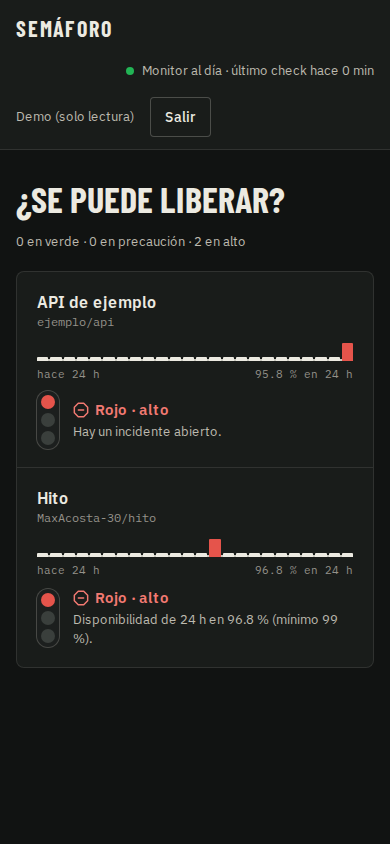
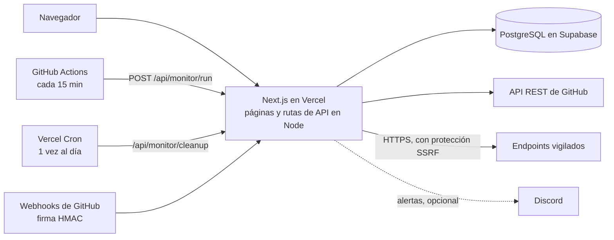

# Semáforo

**Saber si se puede liberar, antes de liberar.**

Antes de publicar una versión hay que revisar a mano el CI, los PRs, si el sitio responde y si la checklist está completa. Semáforo junta esas señales de un producto web y responde con un color y su motivo: verde se puede publicar, amarillo hay que revisar, rojo no se publica.

Proyecto de portafolio de Max Acosta (TypeScript, React, Next.js, Node.js y PostgreSQL).

## Demo

Pendiente de despliegue (falta la base en Supabase). Mientras tanto se corre en local: ver [Correr en local](#correr-en-local). La demo entra con el botón "Entrar como demo" (rol de solo lectura).

## Capturas

Tomadas de la app local (build de producción) con los datos de `tests/e2e/semilla.sql`. Hay más tamaños y temas en [`docs/capturas/`](docs/capturas/); se regeneran con `scripts/capturas.mjs`.

| Tablero                                                         | Detalle de un producto en rojo                                               |
| --------------------------------------------------------------- | ---------------------------------------------------------------------------- |
|  |  |

| Página pública (celular)                                                     | Tablero (celular, oscuro)                                              |
| ---------------------------------------------------------------------------- | ---------------------------------------------------------------------- |
|  |  |

## Qué hace

Los 9 casos "Debe" (detalle y estado en [`docs/proyecto/03-casos-de-uso.md`](docs/proyecto/03-casos-de-uso.md)):

| #   | Caso                          | Cómo se cumple                                                                                                      | Prueba                                                               |
| --- | ----------------------------- | ------------------------------------------------------------------------------------------------------------------- | -------------------------------------------------------------------- |
| 1   | Iniciar sesión con GitHub     | Auth.js; solo entran cuentas de `members`; el rol va en el JWT y cada ruta valida el permiso                        | `unit/auth`, `integration/productos-api` (lector y demo reciben 403) |
| 2   | Registrar productos           | Formulario y API con Zod; cada URL pasa por la protección SSRF                                                      | `integration/productos-api`, `unit/ssrf`, `unit/slug`                |
| 3   | Revisar endpoints cada 15 min | `POST /api/monitor/run` desde GitHub Actions; guarda estado, latencia y error; timeout de 10 s                      | `integration/monitor`, `monitor-run`, `peticion`, `unit/metricas`    |
| 4   | Estado del repositorio        | CI de `main`, último release y PRs con la API de GitHub; caché de 5 min y ETag                                      | `integration/github` (con MSW)                                       |
| 5   | Calcular el semáforo          | Función pura con todos los motivos; sin datos nunca es verde                                                        | `unit/semaforo`, `integration/estado-producto`, e2e                  |
| 6   | Aprobar una publicación       | Checklist por versión; guarda quién, cuándo y color; con rojo responde 409                                          | `integration/aprobaciones`                                           |
| 7   | Incidentes                    | Se abre tras 3 fallos seguidos y se cierra tras 2 éxitos; índice único parcial evita duplicados                     | `unit/incidentes`, `integration/monitor`                             |
| 8   | Página de estado pública      | `/status/[slug]` solo para productos públicos; sin CI, checklist ni URLs                                            | `integration/estado-producto`, e2e                                   |
| 9   | Probar la demo                | "Entrar como demo" da rol lector; `pnpm db:demo` siembra Hito y 2 productos; placa si el monitor no corre en 45 min | e2e, `unit/auth`, `integration/sembrar-demo`                         |

Los 3 "Debería" también están hechos: alertas de incidentes a **Discord** (`src/lib/alertas/discord.ts`), **webhooks de GitHub** con firma HMAC (`POST /api/github/webhook`) y **OpenAPI** del endpoint público (`public/openapi.json`, `GET /api/status/[slug]`).

Reglas del semáforo (`src/lib/domain/semaforo.ts`): rojo si falla el CI de `main`, hay un incidente abierto o la disponibilidad de 24 h es menor a 99 %; amarillo si la checklist está incompleta, el p95 supera el máximo, el último check tiene más de 45 min o faltan datos.

## Arquitectura



Estructura: `src/app` (páginas y rutas), `src/lib/domain` (reglas puras), `src/lib/monitor` (revisiones y SSRF), `src/lib/github`, `src/lib/db` (Drizzle), `drizzle/` (migraciones), `tests/`.

## Decisiones clave

ADRs en [`docs/decisiones/`](docs/decisiones/).

| Decisión                                                        | Por qué                                                            | Por qué no                                                                 |
| --------------------------------------------------------------- | ------------------------------------------------------------------ | -------------------------------------------------------------------------- |
| Next.js App Router y TypeScript estricto                        | Páginas y backend en Node con un solo despliegue                   | Express aparte: sería otro servicio sin un caso que lo necesite            |
| CSS Modules y variables CSS                                     | Demuestra CSS escrito a mano                                       | Tailwind: ocultaría ese conocimiento                                       |
| PostgreSQL con Drizzle (Supabase solo como base)                | SQL explícito, ligero en serverless, migraciones versionadas       | Prisma (pesado en serverless), MongoDB (datos relacionales), Supabase Auth |
| RLS sin políticas en toda tabla (ADR 0002)                      | Una prueba falla si una tabla nueva lo olvida                      | Solo apagar la Data API: es un interruptor sin versionar ni probar         |
| next-auth 4.24 con GitHub (ADR 0003)                            | Estable y compatible con Next 16                                   | v5: sigue en beta                                                          |
| Zod                                                             | Un esquema valida servidor y formulario                            | Validación manual repetida por ruta                                        |
| Monitor en GitHub Actions + una ruta de API; sin Redis ni colas | A 15 min alcanza con PostgreSQL; el cron de Vercel Hobby es diario | Vercel Cron para el monitor; servicio de monitoreo aparte                  |
| Esquema que crece por caso (ADR 0001)                           | Cada columna nace con su prueba                                    | Las 9 tablas de golpe: habría que adivinar columnas                        |

## Seguridad

Lo que hay en el código:

- **SSRF** (`src/lib/monitor/ssrf.ts`, `peticion.ts`): solo `https` al puerto 443, sin credenciales en la URL, todas las IPs resueltas deben ser públicas (bloquea loopback, privadas, CGNAT, enlace local y metadatos). El monitor se conecta a la IP ya validada (anti DNS rebinding), no sigue redirecciones y revalida en cada corrida. Prueba: `tests/unit/ssrf.test.ts`.
- **Permisos en el servidor** (`src/lib/auth/`): cada ruta de escritura valida la sesión; lector y demo reciben 403, sin sesión 401.
- **Secretos de rutas automáticas** (`src/lib/monitor/auth.ts`): `Authorization: Bearer` con `MONITOR_SECRET` (monitor) o `CRON_SECRET` (limpieza), comparado con `timingSafeEqual`.
- **Webhooks** (`src/app/api/github/webhook/route.ts`): firma `X-Hub-Signature-256` HMAC-SHA256 con `timingSafeEqual`, cuerpo máximo de 1 MB, idempotencia por `X-GitHub-Delivery`.
- **Límites de intentos** (`src/lib/limites.ts`, en PostgreSQL): "Entrar como demo" 10 por minuto por IP y `GET /api/status/[slug]` 60 por minuto por IP.
- **Base de datos:** RLS activado en todas las tablas (ADR 0002, `tests/integration/rls.test.ts`).
- **Secretos:** solo en `.env` local (ignorado por git), en variables de Vercel y en secretos de GitHub Actions. El repositorio no contiene ninguno.
- **Cabeceras:** CSP, `X-Content-Type-Options: nosniff`, `Referrer-Policy`, `X-Frame-Options: DENY` y `Permissions-Policy` en `next.config.ts`. La CSP admite scripts en línea porque el prerender parcial no permite nonce ([ADR 0004](docs/decisiones/0004-cabeceras-y-csp.md)); verificado en el navegador sin violaciones.

## Pruebas

**181 pruebas, todas pasan** (corridas el 20 nov 2026):

- **178 con Vitest** en 21 archivos: 86 unitarias (`tests/unit`: reglas del semáforo, métricas, incidentes, SSRF, auth) y 92 de integración (`tests/integration`: rutas de API contra PostgreSQL real, GitHub y endpoints simulados con MSW).
- **3 e2e con Playwright** (`tests/e2e`): entrar como demo, abrir un producto en rojo y ver su motivo; página pública solo con productos públicos; la demo no ve el formulario.

El CI (`.github/workflows/ci.yml`) corre formato, lint, tipos, migraciones, pruebas, build y e2e contra un PostgreSQL de servicio.

```sh
pnpm test                      # Vitest (requiere la base: docker compose up -d --wait y pnpm db:migrate)
pnpm build
docker compose exec -T postgres psql "$DATABASE_URL" -v ON_ERROR_STOP=1 < tests/e2e/semilla.sql
pnpm test:e2e                  # levanta el build en el puerto 3100
```

## Correr en local

Requiere Node 24, pnpm (vía Corepack) y Docker.

```sh
corepack enable pnpm
pnpm install
cp .env.example .env
docker compose up -d --wait
pnpm db:migrate
pnpm db:demo      # siembra Hito y 2 productos de ejemplo (idempotente)
pnpm dev
```

En `.env` pon un `NEXTAUTH_SECRET` cualquiera (por ejemplo `openssl rand -hex 32`); sin credenciales de GitHub solo aparece "Entrar como demo". Otros comandos: `pnpm lint`, `pnpm typecheck`, `pnpm format:check`.

### Variables de entorno

Ver `.env.example`. Sin valores aquí.

| Variable                     | Para qué                                                           | Obligatoria                               |
| ---------------------------- | ------------------------------------------------------------------ | ----------------------------------------- |
| `DATABASE_URL`               | Conexión a PostgreSQL                                              | Sí                                        |
| `NEXTAUTH_SECRET`            | Firma de la sesión                                                 | Sí                                        |
| `NEXTAUTH_URL`               | URL pública de la app                                              | Sí                                        |
| `MONITOR_SECRET`             | Autoriza `POST /api/monitor/run` (también como secreto de Actions) | Sí, para correr el monitor                |
| `CRON_SECRET`                | Autoriza la limpieza diaria de Vercel Cron                         | Sí, en producción                         |
| `GITHUB_ID`, `GITHUB_SECRET` | OAuth App de GitHub                                                | No (sin ellas solo la demo)               |
| `GITHUB_TOKEN`               | Token de solo lectura para el estado del repo                      | No (sin él el CI cuenta como desconocido) |
| `GITHUB_WEBHOOK_SECRET`      | Firma HMAC de los webhooks                                         | No (sin él la ruta responde 503)          |
| `DISCORD_WEBHOOK_URL`        | Alertas de incidentes                                              | No                                        |
| `APP_URL`                    | Enlace en las alertas                                              | No                                        |

## Límites conocidos y NO VERIFICADO

- **NO VERIFICADO: despliegue.** No hay Supabase, Vercel ni URL pública; `deploy.yml` no se ha ejecutado contra producción.
- **NO VERIFICADO: monitor real.** No hay 7 días de datos reales; GitHub Actions puede retrasar o saltarse corridas.
- **NO VERIFICADO: OAuth real.** Los casos 1, 2 y 6 se probaron con sesiones simuladas; falta la OAuth App y registrar cuentas en `members`.
- **NO VERIFICADO: Discord y webhooks reales.** Probados con simulaciones (firmas de ejemplo, MSW), no contra Discord ni GitHub.
- La línea de tiempo de incidentes y el aviso de 45 minutos no tienen prueba automatizada propia.
- `/status/[slug]` de un producto privado muestra "no encontrado" con `noindex` pero responde HTTP 200 (streaming de Next).
- Fuera de alcance: intervalos menores a 15 min, varias regiones, equipos, despliegues automáticos desde Semáforo y app móvil.
